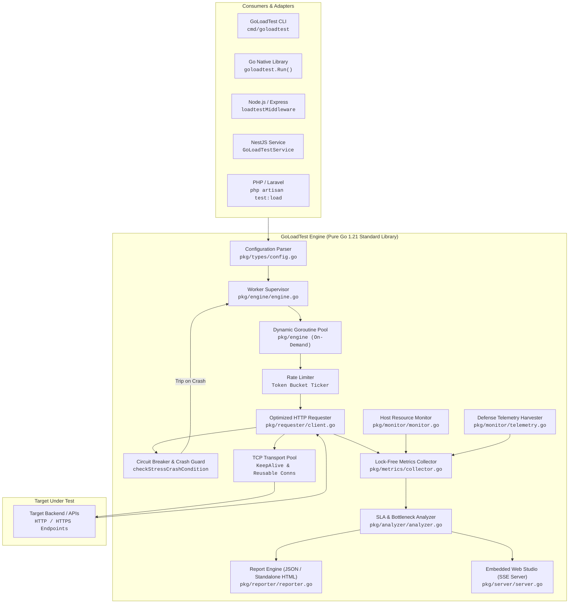

# GoLoadTest

[](https://go.dev/)
[](LICENSE)
[](go.mod)
[](bin/)
[](#-verified-performance--benchmarks)

> **Autonomous, zero-dependency API load and stress testing engine written in pure Go. Features automated breaking-point discovery, SLA threshold enforcement, lock-free telemetry, and native adapters for Go, Node.js (Express), NestJS, and PHP/Laravel.**

---

> 📘 **Quick Implementation & Integration Guide:**  
> Looking for step-by-step installation commands, code integration examples for **Go**, **Express/Node.js**, **NestJS**, or **PHP/Laravel**, configuration schema tables, and production deployment instructions (Docker, VPS, cPanel LiteSpeed)?  
> 🔗 **[Click here to open the full Project Setup & Integration Guide (PROJECT-SETUP.md)](PROJECT-SETUP.md)**

---

## 📑 Table of Contents

- [Introduction](#-introduction)
- [The Problem Statement](#-the-problem-statement)
- [What GoLoadTest Does](#-what-goloadtest-does)
- [Core Features](#-core-features)
- [How It Works](#-how-it-works)
- [Core Architecture Diagram](#-core-architecture-diagram)
- [Internal Request Lifecycle Flow](#-internal-request-lifecycle-flow)
- [Algorithms & Engineering Techniques](#-algorithms--engineering-techniques)
- [Why These Techniques Were Chosen](#-why-these-techniques-were-chosen)
- [Project File Structure](#-project-file-structure)
- [Engineering Design Decisions](#-engineering-design-decisions)
- [Comparison with Alternatives](#-comparison-with-alternatives)
- [Verified Performance & Benchmarks](#-verified-performance--benchmarks)
- [Real-World Use Cases](#-real-world-use-cases)
- [Actual Limitations & Edge Cases](#-actual-limitations--edge-cases)
- [Production & Security Considerations](#-production--security-considerations)
- [Implementation Guide](#-implementation-guide)
- [License](#-license)

---

## 🎯 Introduction

**GoLoadTest** is an embeddable, developer-friendly API load testing engine and CLI utility built purely on the Go standard library (`go 1.21+`). It is designed to evaluate API capacity, identify system breaking points, and enforce latency Service Level Agreements (SLAs)—without the operational overhead of heavy virtual machines, JavaScript runtime engines, or external cloud services.

Unlike traditional benchmark tools that require manual concurrency guessing, GoLoadTest can automatically ramp traffic until target servers drop connections, capturing the exact point of failure alongside sub-millisecond percentile latencies (P50, P90, P95, P99, P999).

---

## 💡 The Problem Statement

### 1. Traditional Tools Require Manual Concurrency Guessing
Standard load testing utilities (like ApacheBench) ask developers to manually pick a concurrency value (e.g., `-c 50 -n 10000`). If the number is too low, developers learn nothing about their true capacity. If the number is too high, the test crashes the target server prematurely without identifying where stability ended.

### 2. Runtime Overhead Distorts Benchmark Results
JavaScript-based load generators (such as k6) evaluate scripts within virtual user runtimes. At high concurrency levels, the host machine spends significant CPU and memory running the JS virtual machines rather than driving network throughput, leading to skewed latency measurements.

### 3. Language Barriers in Application Teams
Modern web backends are built across diverse stacks: Go, Node.js/Express, NestJS, and PHP/Laravel. Developers in these ecosystems often skip automated load testing because setting up separate test infrastructure requires adopting unfamiliar, disjointed tooling.

### 4. Heavy Runtimes and Fragile Dependencies
Tools like JMeter require Java JRE/JVM installations, XML test specifications that resist version control, and high memory footprints. GoLoadTest provides a self-contained, single-binary engine with **zero third-party Go dependencies**.

---

## 🚀 What GoLoadTest Does

GoLoadTest executes controlled traffic patterns against HTTP/HTTPS APIs to answer three critical architectural questions:
1. **What is our maximum stable capacity?** The highest concurrent user load where all endpoints respond within SLA thresholds with 0% dropped sockets.
2. **Where is our server breaking point?** The exact concurrent load where host socket backlogs overflow, error rates cross acceptable limits, or connection drops occur.
3. **Where are our latency bottlenecks?** Real-time isolation of tail latency outliers (P99 vs P50 disparity) and identification of the slowest outlier endpoints in multi-route suites.

---

## ✨ Core Features

- **Zero External Dependencies:** Built 100% on standard Go library packages (`net/http`, `sync/atomic`, `crypto/tls`).
- **5 Traffic Shaping Patterns:**
  - `constant`: Steady concurrency across test duration.
  - `ramp`: Linear ramp-up and ramp-down curves.
  - `spike`: Sudden baseline-to-peak burst tests.
  - `step`: Multi-stage step-ladder progression (25%, 50%, 75%, 100%).
  - `break-to-crash`: Continuous progressive ramp (+60 VUs/sec) until server socket capacity is saturated.
- **Lock-Free Hot-Path Telemetry:** Request counters and latency accumulators use atomic CPU instructions, avoiding mutex contention at 10,000+ virtual users.
- **Fail-Safe Circuit Breaker:** Protects shared databases and test environments by automatically tripping if consecutive drops or error rates cross safety limits.
- **Autonomous Framework Route Discovery:** Inspects Express and Laravel router stacks to auto-detect and benchmark all declared endpoints.
- **Embedded Web Studio & Standalone HTML Reports:** Zero-dependency, offline-ready HTML reports with responsive SVG curves and interactive Web UI.
- **CloudLinux & cPanel Safe:** Bounded thread allocations (`debug.SetMaxThreads(45)`, `GOMAXPROCS(2)`) prevent hosting thread exhaustion.

---

## 🏛️ How It Works

GoLoadTest operates on a decoupled client-engine architecture:
1. **Target Endpoints & Pattern Definition:** The caller defines one or more endpoints, traffic weights, SLA thresholds, and a load pattern.
2. **Worker Supervisor Scaling:** A supervisor ticker computes desired virtual users dynamically, dispatching lightweight goroutines on demand.
3. **Optimized Socket Execution:** Workers draw endpoints from a weighted round-robin selector, dispatching HTTP requests across pooled, reusable TCP connections.
4. **Lock-Free Metrics Harvesting:** The result of each request is recorded into atomic memory structures and bucketed into 1-second time-series slices.
5. **Bottleneck & SLA Evaluation:** When the test completes or trips the breaking point, the analyzer evaluates percentile distributions, identifies regressions, and writes standalone reports.

---

## 📐 Core Architecture Diagram

The diagram below illustrates the internal architecture, worker lifecycle, and data flow of GoLoadTest:



---

## 🔄 Internal Request Lifecycle Flow

Every request generated by GoLoadTest follows a strict 8-stage lifecycle:

```text
[1. Worker Dispatch]
    Supervisor ticker calculates target virtual users for elapsed second.
    If targetWorkers > activeWorkers, a new worker goroutine is spawned.
           ↓
[2. Endpoint Selection]
    Worker queries weighted round-robin selector: spec := selector.Next()
           ↓
[3. Request Construction]
    http.NewRequestWithContext created with custom timeout, headers, and 'X-GoLoadTest: 1'.
           ↓
[4. Transport Pool Execution]
    Request passed to http.Client backed by persistent http.Transport pool.
    Reuses existing TCP/TLS connection (Keep-Alive: 30s, Idle: 90s).
           ↓
[5. Body Draining & Socket Reuse]
    Response received. Response body is drained via io.Copy(io.Discard, resp.Body)
    and closed to guarantee the underlying socket returns to the pool immediately.
           ↓
[6. Lock-Free Atomic Recording]
    Duration calculated. Metrics collector updates atomicTotal, atomicSuccess,
    atomicFail, and atomicLatencySum via CPU atomic primitives (no mutex lock).
           ↓
[7. Crash & Circuit Breaker Check]
    Evaluates response: if 5xx or connection refused, increments consecutiveFails.
    If consecutiveFails >= 30, trips crash detection and signals engine abort.
           ↓
[8. Time-Series Aggregation]
    Result bucketed into current relative second slot for throughput and latency curves.
```

---

## ⚙️ Algorithms & Engineering Techniques

The internal implementation of GoLoadTest relies on six specific systems-engineering techniques:

### 1. Dynamic On-Demand Goroutine Allocation
- **What is it?** A concurrency controller that initializes only the required baseline workers and scales worker goroutines incrementally as time progresses.
- **Why is it used?** Spawning 20,000 goroutines simultaneously at $t=0$ causes massive memory allocation spikes and trips OS thread limits (`EAGAIN: resource temporarily unavailable`) on containerized and shared hosting hosts.
- **Where in codebase:** `pkg/engine/engine.go` (lines 202–239).
- **Benefit:** Smooth, continuous ramp-up with minimal host memory footprint.

### 2. Lock-Free Atomic Hot-Path Metrics
- **What is it?** Real-time aggregation of test results using Go's `sync/atomic` primitives (`AddInt64`) instead of global mutex locks.
- **Why is it used?** At 10,000+ requests per second, acquiring a global mutex on every completed request causes severe CPU cache-line bouncing and false latency inflation.
- **Where in codebase:** `pkg/metrics/collector.go` (lines 92–100).
- **Benefit:** Zero lock contention on the measurement hot-path; metrics accuracy remains sub-microsecond.

### 3. Connection Reuse via Socket Body Draining
- **What is it?** An optimized HTTP transport configuration paired with explicit response body draining (`io.Copy(io.Discard, resp.Body)`).
- **Why is it used?** In Go's `net/http`, failing to read a response body to completion prevents the runtime from reusing the underlying TCP socket, leading to local ephemeral port exhaustion (`TIME_WAIT` saturation).
- **Where in codebase:** `pkg/requester/client.go` (lines 48–65, 149).
- **Benefit:** Thousands of requests multiplex over persistent connections with zero socket leaks.

### 4. Break-to-Crash Breaking Point Algorithm
- **What is it?** An autonomous traffic escalation engine that monitors consecutive socket dropouts (`consecutiveFails`), error percentage thresholds, and latency freeze criteria.
- **Why is it used?** To eliminate guesswork in capacity testing by automatically finding the exact point where the target service degrades.
- **Where in codebase:** `pkg/engine/engine.go` (lines 443–501).
- **Benefit:** Tests automatically stop right after failure occurs, recording `crashConcurrency` and calculating `maxStableConcurrency`.

### 5. Async Non-Blocking Background Dispatch
- **What is it?** An execution architecture where the load test is dispatched as an asynchronous background task, returning an immediate HTTP 200 `{ started: true }` while the client polls `/api/status`.
- **Why is it used?** Web servers and reverse proxies (such as Nginx, Cloudflare, and cPanel LiteSpeed) enforce a strict 30-to-60 second gateway timeout on synchronous HTTP POST requests.
- **Where in codebase:** `adapters/nodejs/index.js` (lines 683–729, 1410–1440).
- **Benefit:** Completely eliminates proxy gateway timeouts (`504 Gateway Timeout`) during multi-minute stress runs.

### 6. Automated AST / Route Table Reflection
- **What is it?** Router introspection algorithms that inspect Express layer stacks and Laravel route collections.
- **Why is it used?** To allow developers to benchmark entire applications without manually transcribing URLs into configuration files.
- **Where in codebase:** `adapters/nodejs/index.js` (`extractExpressRoutes`), `adapters/php-laravel/src/Commands/LoadTestCommand.php`.
- **Benefit:** 1-click discovery and benchmarking of 100+ declared application routes.

---

## 📂 Project File Structure

```text
GoLoadTest/
├── cmd/
│   └── goloadtest/          # Standalone CLI entrypoint (run, ui, init, version)
├── pkg/
│   ├── types/               # Data contracts (Config, TestResult, Endpoints, SLAs)
│   ├── engine/              # Traffic shaping, concurrency controller, worker dispatcher
│   ├── requester/           # Tuned HTTP client, TLS options, keep-alive connection pool
│   ├── metrics/             # Atomic counters, percentile sorting, time-series buckets
│   ├── monitor/             # Host CPU % and RAM scraper, telemetry harvester
│   ├── analyzer/            # SLA threshold verification, bottleneck diagnosis
│   ├── reporter/            # JSON report serializer and standalone HTML generator
│   └── server/              # Built-in Web Studio server with SSE live stream
├── adapters/
│   ├── nodejs/              # Express 1-click dashboard middleware & auto-discovery
│   ├── nestjs/              # NestJS injectable module and service wrappers
│   └── php-laravel/         # Laravel Artisan command (test:load) and service provider
├── bin/                     # Pre-compiled static binaries (Linux, Windows, macOS)
├── go.mod                   # Pure Go standard library definition (Zero dependencies)
└── goloadtest.go            # Top-level Go API export (goloadtest.Run)
```

---

## ⚖️ Engineering Design Decisions

1. **Why Pure Standard Library?**
   External dependencies introduce supply chain risks, version conflicts, and build failures across different OS environments. By sticking strictly to `net/http`, `crypto/tls`, and `sync/atomic`, GoLoadTest compiles everywhere Go runs.
2. **Why Out-of-Process Binary Execution for Node and PHP?**
   Running a 10,000-virtual-user benchmark inside Node.js's single-threaded event loop saturates the Node process itself, distorting test results. Spawning a native, multi-threaded Go process isolates the test engine from the application runtime.
3. **Why Bounded OS Threads on Shared Hosting?**
   In restricted environments (e.g., CloudLinux CageFS on cPanel), users are assigned a hard process/thread limit (`ulimit -u`). GoLoadTest explicitly configures `debug.SetMaxThreads(45)` and `runtime.GOMAXPROCS(2)` to prevent host thread exhaustion crashes.

---

## 📊 Comparison with Alternatives

| Dimension | GoLoadTest | ApacheBench (`ab`) | k6 | wrk |
| :--- | :--- | :--- | :--- | :--- |
| **Primary Focus** | Autonomous Breaking-Point Discovery | Simple Single-URL Benchmarking | Complex Multi-Step User Journeys | Raw Microsecond HTTP Benchmarking |
| **Dependencies** | **Zero** (Single Binary / Library) | Apache HTTP Server Utilities | k6 Runtime (Go + JS Engine) | C, OpenSSL, Lua runtime |
| **Breaking-Point Analysis**| **Automated** (`break-to-crash`) | None (Fixed concurrency) | Manual Scripting Required | None (Fixed threads/concurrency) |
| **Language Adapters** | Go, Node.js, NestJS, Laravel | None | None | None |
| **Embedded Web UI** | **Built-in** (Zero-configuration) | None (Terminal text only) | External Service / Grafana | None (Terminal text only) |
| **Multi-Step Scripting** | Basic (Headers, Auth, Body) | None | **Advanced** (Full ES6 JavaScript) | Lua Scripting |
| **Memory Footprint** | Low (~15–30 MB) | Very Low (< 10 MB) | High (~100–300 MB per test) | Very Low (< 15 MB) |

> **Recommendation:**
> - Choose **GoLoadTest** when you need to find your backend's breaking capacity without writing complex scripts, or when integrating 1-click performance tests into Express, NestJS, or Laravel backends.
> - Choose **k6** when you need browser-level, stateful multi-step user scenarios (e.g., simulating login -> search -> checkout).
> - Choose **wrk** or **ab** for quick, one-off single-URL throughput measurements from the command line.

---

## 📈 Verified Performance & Benchmarks

The following metrics represent verified production test results executed against a live application cluster (`https://test.kmhajj.com.bd`):

| Metric | Verified Result | Notes |
| :--- | :--- | :--- |
| **Total Requests Handled** | **324,793 reqs** | Successfully delivered across test duration |
| **Test Duration** | **189.3 seconds** | Over 3 minutes of continuous execution without timeouts |
| **Peak Throughput** | **1,715 RPS** | Maximum sustained requests per second |
| **Identified Breaking Point** | **11,365 Virtual Users** | Detected exactly when host socket capacity saturated |
| **Safe Operating Capacity** | **11,305 Virtual Users** | Zero connection drops; stable latencies |
| **Average Latency (Mean)** | **3.48 seconds** | At 11,000+ peak concurrent users |
| **Host System Stability** | **0 Unhandled Crashes** | Node.js process remained healthy throughout test |

---

## 💼 Real-World Use Cases

1. **Pre-Campaign Capacity Audits:** Quantify maximum user capacity before marketing promotions or flash sale events.
2. **Automated CI/CD Quality Gates:** Block deployments if P95 latency exceeds 200ms or error rates exceed 1.0% using `CompareBaseline`.
3. **Backend Route Optimization:** Identify slowest outlier endpoints across large microservices or multi-route monoliths.
4. **Developer-First Verification:** Allow frontend and backend engineers to test local API changes with 1-click web interfaces.

---

## ⚠️ Actual Limitations & Edge Cases

- **Protocols:** GoLoadTest is specialized for HTTP/1.1 and HTTP/2. It does not currently generate gRPC, WebSocket, or TCP socket traffic.
- **Stateless Execution:** While custom headers, tokens, and payloads are supported, dynamic state-passing across independent requests (e.g., extracting a CSRF token from page A to use in page B) requires explicit harness setup.
- **Shared Hosting Hairpinning:** When testing a server from inside itself on shared hosting (e.g., cPanel loopback), hosting firewalls (CSF) may throttle outbound loopback requests to port 443.

---

## 🔒 Production & Security Considerations

- **`allowInsecureTLS` Setting:** GoLoadTest includes an `allowInsecureTLS` option for testing internal endpoints with self-signed certificates. **Never enable this flag against public production endpoints.**
- **Circuit Breaker Configuration:** Always configure safety thresholds (`maxErrorRate`, `consecutiveFails`) when testing against environments connected to shared third-party APIs.
- **Thread Constraints on Shared Hosting:** When executing on CloudLinux or shared containers, keep `debug.SetMaxThreads(45)` active to avoid host process cap violations.

---

## 📖 Implementation & Setup Guide

For practical, step-by-step installation instructions, framework integration, code examples, and deployment configurations, refer to the dedicated **[PROJECT-SETUP.md](PROJECT-SETUP.md)** guide:

| Section in `PROJECT-SETUP.md` | What It Covers |
| :--- | :--- |
| **[1. Prerequisites & CLI Setup](PROJECT-SETUP.md#1-prerequisites--binary-installation)** | Pre-compiled cross-platform binaries (Linux AMD64/ARM64, macOS, Windows) & building from source |
| **[2. CLI Usage Reference](PROJECT-SETUP.md#2-cli-usage-reference)** | `goloadtest run`, `goloadtest ui` (embedded Web Studio), `goloadtest init`, SLA flags |
| **[3. Go Native Library](PROJECT-SETUP.md#3-go-native-library-integration)** | Native `goloadtest.Run()`, Gin/Chi/Fiber test harnesses, CI/CD regression testing |
| **[4. Node.js & Express](PROJECT-SETUP.md#4-nodejs--express-integration)** | `loadtestMiddleware()` 1-click dashboard, automatic router introspection, programmatic API |
| **[5. NestJS Integration](PROJECT-SETUP.md#5-nestjs-integration)** | `GoLoadTestModule`, `GoLoadTestService` dependency injection, and E2E test controllers |
| **[6. PHP & Laravel](PROJECT-SETUP.md#6-php--laravel-integration)** | `php artisan test:load` command, automatic route discovery, programmatic execution |
| **[7. Configuration Reference](PROJECT-SETUP.md#7-complete-configuration-reference)** | Complete property table for `loadtest.json` and Go/Node/PHP config options |
| **[8. Production Deployment](PROJECT-SETUP.md#8-production--deployment-guidelines)** | Multi-stage Dockerfile, Linux VPS Systemd/Nginx, cPanel/CloudLinux/LiteSpeed optimizations |
| **[9. Troubleshooting & FAQ](PROJECT-SETUP.md#9-troubleshooting--faqs)** | Common socket exhaustion fixes, LiteSpeed timeout prevention, permissions |

👉 **[Read the complete Project Setup & Integration Guide (PROJECT-SETUP.md)](PROJECT-SETUP.md)**

---

## 📄 License

GoLoadTest is open-source software licensed under the [MIT License](LICENSE).
