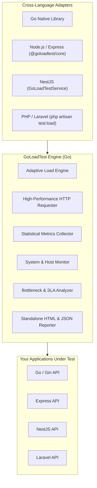

# ⚡ GoLoadTest

[](https://github.com/goloadtest/goloadtest/actions)
[](https://goreportcard.com/report/github.com/goloadtest/goloadtest)
[](LICENSE)
[](#cross-language-integration)

> **High-Performance Cross-Language API Performance & System Testing Suite**  
> Test API latency, throughput, breaking points, and bottlenecks across **Go, Node.js, NestJS, PHP, and Laravel** without changing business logic or managing cloud infrastructure.

---

## 🌟 Why GoLoadTest?

- **🚀 Ultra-High Performance Core:** Written in Go with lightweight goroutines capable of generating **30,000+ Requests/Sec** on a standard laptop.
- **🌐 5 Ecosystem Integrations:** Native Go package, Node.js/Express SDK, NestJS Testing Service, and PHP/Laravel Artisan commands.
- **🛡️ Built-in Circuit Breaker:** Protects staging and local databases by auto-aborting tests if error rates exceed safety thresholds.
- **📊 Interactive Standalone Reports:** Generates zero-dependency, single-file HTML dashboards with SVG sparkline charts, SLA checks, and status distributions.
- **🔍 Automated Bottleneck Diagnostics:** Automatically detects tail latency spikes, database lock contention symptoms, and outlier slow endpoints.
- **🔒 Zero Cloud Deployment Needed:** 100% offline, privacy-first, and local. Runs in CLI or directly within your existing CI/CD test suites.

---

## 🏛️ Architecture



---

## 📦 Quick Start

### 1. CLI Usage (Standalone Binary)

Download the binary from [GitHub Releases](https://github.com/goloadtest/goloadtest/releases) or build from source:

```bash
# Clone and build
git clone https://github.com/goloadtest/goloadtest.git
cd GoLoadTest
go build -o goloadtest.exe ./cmd/goloadtest

# Initialize a starter configuration
./goloadtest init

# Run a test against your endpoint
./goloadtest run --url http://localhost:8080/api/users --duration 10s --concurrency 25

# Or run using your configuration file
./goloadtest run --config loadtest.json
```

---

### 2. Go Native Integration

```go
package main

import (
    "context"
    "fmt"
    "time"
    "github.com/goloadtest/goloadtest"
)

func main() {
    cfg := goloadtest.DefaultConfig()
    cfg.Duration = 10 * time.Second
    cfg.Concurrency = 25
    cfg.Endpoints = []goloadtest.EndpointSpec{
        {
            Name:   "Get Users",
            URL:    "http://localhost:8080/api/users",
            Method: "GET",
        },
    }
    cfg.Thresholds = goloadtest.Thresholds{
        MaxP95:       50 * time.Millisecond,
        MaxErrorRate: 1.0,
    }

    result, err := goloadtest.Run(context.Background(), cfg)
    if err != nil {
        panic(err)
    }

    fmt.Printf("Total Requests: %d | Throughput: %.1f RPS | Passed: %v\n",
        result.TotalRequests, result.ThroughputRPS, result.Passed)
}
```

---

### 3. Node.js & Express Integration

Install the adapter:
```bash
npm install @goloadtest/core
```

Use in your test files or scripts:
```javascript
const { runLoadTest } = require('@goloadtest/core');

async function benchmark() {
  const result = await runLoadTest({
    name: 'Express User API Test',
    url: 'http://localhost:3000/api/users',
    duration: '10s',
    concurrency: 20,
    thresholds: {
      maxP95: '50ms',
      maxErrorRate: 1.0
    }
  });

  console.log(`Requests: ${result.totalRequests}, RPS: ${result.throughputRps}, Passed: ${result.passed}`);
}

benchmark();
```

---

### 4. NestJS Integration

In your NestJS e2e test suite:
```typescript
import { GoLoadTestService } from '@goloadtest/core/nestjs';

describe('UsersController (Load Test)', () => {
  const loadTester = new GoLoadTestService();

  it('should handle 50 concurrent users within SLA', async () => {
    const result = await loadTester.run({
      url: 'http://localhost:3000/api/users',
      duration: '10s',
      concurrency: 50,
      thresholds: {
        maxP95: '80ms',
        maxErrorRate: 0.5,
      },
    });

    expect(result.passed).toBe(true);
  });
});
```

---

### 5. PHP & Laravel Integration

Install via Composer:
```bash
composer require goloadtest/goloadtest-php
```

#### Run via Laravel Artisan Command:
```bash
php artisan test:load --url=http://localhost:8000/api/users --duration=15s --concurrency=30 --max-p95=100ms
```

#### Run via PHP Service:
```php
use GoLoadTest\GoLoadTest;

$result = GoLoadTest::run([
    'name' => 'Laravel Checkout Benchmark',
    'url' => 'http://localhost:8000/api/checkout',
    'method' => 'POST',
    'duration' => '10s',
    'concurrency' => 20,
    'thresholds' => [
        'maxP95' => '150ms',
        'maxErrorRate' => 1.0,
    ],
]);

if (!$result['passed']) {
    throw new Exception("SLA Thresholds breached!");
}
```

---

## ⚙️ Configuration File Schema (`loadtest.json`)

```json
{
  "name": "API Benchmark Suite",
  "endpoints": [
    {
      "name": "List Products",
      "url": "http://localhost:8080/api/products",
      "method": "GET",
      "timeout": "5s",
      "expectedStatus": [200],
      "weight": 4
    },
    {
      "name": "Create Order",
      "url": "http://localhost:8080/api/orders",
      "method": "POST",
      "headers": {
        "Content-Type": "application/json",
        "Authorization": "Bearer secret_token"
      },
      "body": "{\"productId\": 1, \"quantity\": 2}",
      "timeout": "5s",
      "expectedStatus": [201],
      "weight": 1
    }
  ],
  "duration": "30s",
  "concurrency": 50,
  "rampUp": "5s",
  "rampDown": "2s",
  "pattern": "constant",
  "circuitBreaker": {
    "enabled": true,
    "maxErrorRate": 50.0,
    "consecutiveFails": 100
  },
  "thresholds": {
    "maxP95": "200ms",
    "maxP99": "500ms",
    "maxAvgLatency": "100ms",
    "maxErrorRate": 2.0,
    "minThroughput": 500.0
  },
  "monitor": {
    "enabled": true,
    "localHost": true
  },
  "outputFormat": "all",
  "outputPath": "./results"
}
```

---

## 📈 Interactive HTML Report

GoLoadTest generates a standalone HTML report with:
- **Key Cards:** Requests, RPS, Latency Percentiles (Min, Avg, P50, P95, P99), Error Rate, Host CPU & RAM.
- **Sparkline Timeline Charts:** Dynamic throughput and latency trends.
- **SLA Thresholds:** Automatic PASS/FAIL verification with colored tags.
- **Automated Bottleneck Insights:** Identifies P99 tail latency outliers, slow endpoints, and 502/429 spikes.
- **Zero External CDNs:** Fully self-contained single-file HTML that opens offline anywhere.

---

## 🔬 Benchmark Results

Benchmark executed on standard multi-core developer workstation (Windows 11 / AMD Ryzen / 16GB RAM):

| Test Target | Concurrency | Total Requests | Throughput (RPS) | P95 Latency |
| :--- | :--- | :--- | :--- | :--- |
| **Go / Gin API** | 20 | 64,830 | **21,598 RPS** | 1.07 ms |
| **Node.js Express** | 15 | 33,067 | **11,018 RPS** | 4.25 ms |

---

## 🤝 Contributing

Pull requests are welcome! For major changes, please open an issue first to discuss what you would like to change.

```bash
# Run tests
go test -v ./...

# Run benchmarks
go test -bench=.
```

---

## 📄 License

[MIT](LICENSE) © 2026 GoLoadTest Contributors
