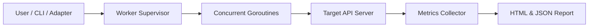

# GoLoadTest

[](https://go.dev/)
[](LICENSE)
[](go.mod)
[](bin/)

> **Fast, simple, and zero-dependency API load testing tool written in Go. Automatically finds your server's breaking point and works with Go, Node.js, NestJS, PHP, and Laravel.**

---

## ⚡ Quick Start

### 1. Download or Install
- **Go CLI / Library:**
  ```bash
  go install github.com/Zihad-Bepari/GoLoadTest/cmd/goloadtest@latest
  ```
- **Node.js / NestJS:**
  ```bash
  npm install github:Zihad-Bepari/GoLoadTest
  ```
- **PHP / Laravel:**
  ```bash
  composer require zihad-bepari/goloadtest:dev-main
  ```

---

## 🚀 How to Use in 1 Minute

### In Go
```go
package main

import (
    "context"
    "fmt"
    "time"
    "github.com/Zihad-Bepari/GoLoadTest"
    "github.com/Zihad-Bepari/GoLoadTest/pkg/types"
)

func main() {
    cfg := goloadtest.DefaultConfig()
    cfg.Duration = 10 * time.Second
    cfg.Concurrency = 50
    cfg.Endpoints = []types.EndpointSpec{
        {Name: "Get Users", URL: "http://localhost:8080/api/users", Method: "GET"},
    }

    result, err := goloadtest.Run(context.Background(), cfg)
    if err != nil {
        panic(err)
    }
    fmt.Printf("Handled %d requests at %.1f RPS\n", result.TotalRequests, result.ThroughputRPS)
}
```

### In Node.js (Express)
```javascript
const express = require('express');
const { loadtestMiddleware } = require('goloadtest');

const app = express();

// Open http://localhost:3000/loadtest in your browser for 1-click test UI
app.use('/loadtest', loadtestMiddleware());

app.listen(3000, () => console.log('Ready on http://localhost:3000/loadtest'));
```

### In NestJS
```typescript
import { Module } from '@nestjs/common';
import { GoLoadTestModule } from 'goloadtest/nestjs';

@Module({
  imports: [GoLoadTestModule],
})
export class AppModule {}
```

### In Laravel
Run the load test directly from your terminal:
```bash
# Auto-discovers all your Laravel routes and tests them
php artisan test:load

# Or test a specific endpoint
php artisan test:load --url=http://127.0.0.1:8000/api/products --concurrency=50 --duration=15s
```

### CLI Command Line
```bash
# Run a quick 10-second test
goloadtest run --url http://localhost:8080/api/users --duration 10s --concurrency 50

# Launch interactive web dashboard
goloadtest ui
```

---

## 🎯 Key Features

1. **Auto Breaking Point Detection:** Slowly increases traffic until the server starts dropping connections, telling you the exact maximum safe user limit.
2. **Zero External Dependencies:** Built with pure Go standard library. No Docker, Python, or Java required.
3. **Cross-Platform:** Pre-compiled static binaries for Windows, Linux (AMD64 and ARM64), and macOS.
4. **Interactive Dashboard:** Live real-time browser dashboard included for Node.js, Express, and CLI.
5. **Multi-Language Support:** Ready-to-use helpers for Go, Node.js, NestJS, and Laravel.

---

## 📐 Architecture Flow



---

## 📖 Full Documentation

For full configuration tables, Docker setup, and production tuning:
👉 **[Read the complete Project Setup Guide (PROJECT-SETUP.md)](PROJECT-SETUP.md)**

---

## 📄 License

MIT License — Copyright (c) 2026 Zihad Bepari.
