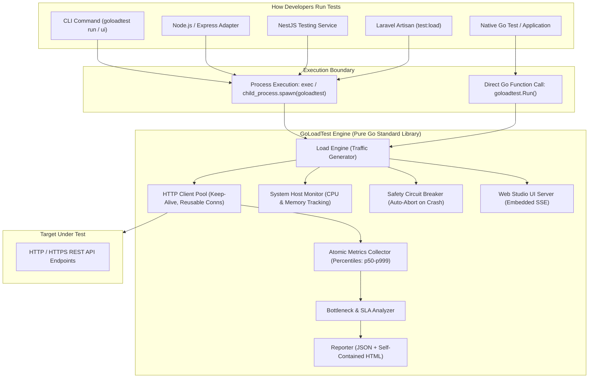

# GoLoadTest

[](https://github.com/Zihad-Bepari/GoLoadTest/actions)
[](https://go.dev/)
[](LICENSE)
[](go.mod)

> **High-performance, developer-first load testing engine with native Go APIs, autonomous route discovery, and cross-language wrapper adapters for Node.js, NestJS, and PHP/Laravel.**

---

## 📑 Table of Contents

- [Overview](#-overview)
- [The Problem & The Solution](#-the-problem--the-solution)
- [How It Works & Architecture](#-how-it-works--architecture)
- [Key Features](#-key-features)
- [Why GoLoadTest?](#-why-goloadtest)
- [Trade-offs & Technical Limitations](#-trade-offs--technical-limitations)
- [Comparison with Existing Alternatives](#-comparison-with-existing-alternatives)
- [When to Use & When NOT to Use](#-when-to-use--when-not-to-use)
- [Quick Start](#-quick-start)
  - [1. Standalone CLI](#1-standalone-cli)
  - [2. Interactive Web Studio](#2-interactive-web-studio)
  - [3. Native Go API](#3-native-go-api)
- [Supported Languages & Ecosystems](#-supported-languages--ecosystems)
- [Verified Benchmarks](#-verified-benchmarks)
- [Security Considerations](#-security-considerations)
- [Documentation Links](#-documentation-links)
- [License](#-license)

---

## 🎯 Overview

**GoLoadTest** is an embeddable load testing engine and CLI utility written in pure Go (standard library only). It is engineered for developers and teams who want to measure API latency, discover breaking points, and enforce performance SLAs directly in local development environments and CI/CD pipelines—without managing heavy JVM runtimes, complex JavaScript test harnesses, or paid cloud load-testing infrastructure.

In addition to its standalone CLI and native Go library API, GoLoadTest provides dedicated adapters for **Node.js (Express)**, **NestJS**, and **PHP (Laravel)** that automatically discover declared application routes and execute stress tests against your local or staging server.

---

## 💡 The Problem & The Solution

### The Problem
- **Traditional load tools are heavy:** Tools like Apache JMeter require a JVM, heavy memory allocation, and complicated XML/GUI test plans that resist version control.
- **Script-heavy tools add runtime overhead:** JavaScript-driven engines (such as k6) consume significant memory and CPU per virtual user due to runtime JS evaluation inside each worker.
- **Language barriers in backend teams:** Node.js, NestJS, and Laravel developers often skip performance tests because setting up separate load testing infrastructure requires learning a completely different domain tool.
- **Silent database overload:** Many load tests run until test databases crash or lock up entirely because the test tool lacks automatic safety cutoffs.

### The Solution
- **Lightweight goroutine core:** GoLoadTest leverages Go's native M:N goroutine scheduler and connection-pooled `net/http` client to generate tens of thousands of requests per second with negligible host footprint.
- **Zero third-party Go dependencies:** The core engine is built purely on the Go standard library, ensuring zero dependency bloat, high binary portability, and minimal attack surface.
- **Fail-safe circuit breakers:** Automatically aborts load execution when target services experience catastrophic failure rates or latency freezes, protecting databases and staging environments.
- **First-class cross-language adapters:** Node.js, NestJS, and Laravel developers can run load tests and auto-discover routes using familiar language constructs, backed by the high-performance Go binary.
- **Zero-dependency standalone HTML reports:** Generates self-contained HTML reports with inline SVG charts and SLA checks that render offline without external CDN dependencies.

---

## 🏛️ How It Works & Architecture

The core load testing engine is compiled into a single binary (`goloadtest`). Native Go applications can import the package directly. Non-Go environments (Node.js, NestJS, PHP/Laravel) interact with the engine via process-spawning wrapper adapters that configure, execute, and deserialize structured JSON reports.



### Execution Flow:
1. **Configuration:** The runner initializes configuration (endpoints, headers, auth, concurrency, duration, SLA thresholds).
2. **Traffic Generation:** The engine schedules requests using the selected pattern (`constant`, `ramp`, `spike`, `step`, or `break-to-crash`).
3. **Safety Evaluation:** The circuit breaker monitors live error rates. If failures exceed the threshold (e.g., >50%), execution terminates immediately.
4. **Metrics Collection:** Latencies are atomically tracked and bucketed into time-series snapshots (RPS, p50, p90, p95, p99, p999, mean, min, max, stdDev).
5. **Analysis & Reporting:** The analyzer evaluates SLA thresholds, identifies tail-latency bottlenecks, and outputs JSON and interactive single-file HTML reports.

---

## ✨ Key Features

- **High-Throughput Concurrent Engine:** Sustains high request volumes with minimal CPU and memory overhead using lightweight goroutines and keep-alive connection pooling.
- **Flexible Load Patterns:** Supports `constant`, `ramp`, `spike`, `step`, and an automated `break-to-crash` stress pattern that dynamically increases load until server failure is detected.
- **Automatic Route Discovery:** Node.js/Express, NestJS, and Laravel adapters inspect application route stacks to test all registered endpoints without manual URL lists.
- **Built-in Circuit Breaker:** Protects services from total exhaustion by auto-aborting tests when error rates, latency limits, or consecutive drop thresholds are breached.
- **Automated Bottleneck Diagnostics:** Automatically highlights tail latency anomalies, error clusters (e.g., 502/504 gateways, 429 rate limits), and slow endpoints.
- **Interactive Web Studio:** Launch `./goloadtest ui` to configure tests, watch live real-time SVG charts via Server-Sent Events (SSE), and inspect performance autopsies.
- **Offline HTML Dashboards:** Standalone, zero-dependency HTML reports with embedded CSS and SVG charts that open directly in any browser without internet access.
- **Zero Third-Party Go Dependencies:** Core library relies exclusively on the standard library (`net/http`, `sync`, `runtime`, `html/template`).

---

## ⚖️ Trade-offs & Technical Limitations

| Feature / Aspect | Implementation Reality | Trade-off / Limitation |
| :--- | :--- | :--- |
| **Go Core vs. Adapters** | Native Go library; wrapper adapters for Node.js, NestJS, PHP | Non-Go runtimes require the compiled `goloadtest` binary installed locally or in `PATH`. |
| **Architecture** | Single-node agent | Not designed for multi-machine distributed load generation (unlike distributed Locust/JMeter clusters). |
| **Protocol Support** | HTTP/1.1 and HTTP/2 over cleartext/TLS | Does not support WebSockets, gRPC, MQTT, or raw TCP/UDP protocols. |
| **Test Scripting** | Declarative configuration (JSON / Go struct / CLI flags) | Does not support executing arbitrary multi-step user session scripts with dynamic state chaining per VU (unlike k6 JS scripts). |
| **Target Scale** | Tens of thousands of RPS on standard hardware | Limited by the single host machine's network stack, available sockets, and CPU cores. |

---

## 📊 Comparison with Existing Alternatives

| Feature | GoLoadTest | k6 | Apache JMeter | wrk / autocannon |
| :--- | :--- | :--- | :--- | :--- |
| **Language & Engine** | Go (Pure stdlib) | Go + JS Runtime (goja) | Java (JVM) | C / Node.js |
| **Resource Consumption** | Very Low (pure goroutines) | Medium (JS VM overhead per VU) | High (JVM thread model) | Minimal (wrk) / Moderate (autocannon) |
| **External Dependencies** | None (Single binary) | None (Single binary) | Java Runtime Environment (JRE) | C toolchain (wrk) / Node.js (autocannon) |
| **Cross-Language Adapters** | Yes (Node, NestJS, Laravel) | No | No | Limited |
| **Automated Route Discovery** | Yes (Express, Nest, Laravel) | No | No | No |
| **Embedded Web Studio UI** | Yes (Zero-config local UI) | Cloud / Extension | Complex GUI client | No |
| **Zero-CDN Standalone HTML** | Yes (Self-contained) | Requires extension/cloud | HTML plugin required | No (terminal only) |
| **Complex Multi-Step Scenarios** | Basic declarative weights | Advanced (Full JS code) | Advanced (GUI test trees) | No (single endpoint focus) |
| **Distributed Testing** | No (Single node) | Yes (k6 Cloud / Kubernetes) | Yes (Remote workers) | No |

---

## 🧭 When to Use & When NOT to Use

### Use GoLoadTest when:
- You need fast, repeatable API performance and regression tests in local development or CI/CD pipelines.
- You are building services in **Go, Node.js, NestJS, or PHP/Laravel** and want automated route discovery.
- You want zero external dependencies (no JRE, no cloud subscriptions, no external database required).
- You want an integrated safety circuit breaker so tests do not take down staging services.
- You want an instant, clean, offline HTML report to share with colleagues.

### Do NOT use GoLoadTest when:
- You need distributed load generation across hundreds of geographically distributed cloud instances (use **k6 Cloud**, **Distributed JMeter**, or **Locust**).
- You need deep multi-step transactional browser workflows with cookie storage and complex user state machines (use **Playwright**, **k6 browser**, or **Gatling**).
- You need to test non-HTTP protocols such as **gRPC**, **WebSockets**, **Kafka**, or **AMQP**.

---

## 🚀 Quick Start

### 1. Standalone CLI

Download the pre-compiled binary from GitHub Releases or build from source:

```bash
# Clone the repository
git clone https://github.com/Zihad-Bepari/GoLoadTest.git
cd GoLoadTest

# Build the binary
go build -o goloadtest.exe ./cmd/goloadtest

# Generate a starter configuration file
./goloadtest init

# Run a quick load test against a target URL
./goloadtest run --url http://localhost:8080/api/users --duration 10s --concurrency 25

# Run a stress test in Break-Until-Crash mode
./goloadtest run --url http://localhost:8080/api/users --break-to-crash --step-vu 10
```

### 2. Interactive Web Studio

Launch the zero-dependency web interface:

```bash
./goloadtest ui --host 127.0.0.1 --port 8989
```

Open your browser at `http://127.0.0.1:8989` to configure endpoints, trigger live tests, watch real-time latency graphs, and inspect automated bottleneck autopsies.

### 3. Native Go API

Add the module to your Go project:

```bash
go get github.com/goloadtest/goloadtest
```

Use `goloadtest.Run` inside your Go application or integration tests:

```go
package main

import (
	"context"
	"fmt"
	"time"

	"github.com/goloadtest/goloadtest"
	"github.com/goloadtest/goloadtest/pkg/types"
)

func main() {
	cfg := goloadtest.DefaultConfig()
	cfg.Name = "User API SLA Benchmark"
	cfg.Duration = 10 * time.Second
	cfg.Concurrency = 25
	cfg.Endpoints = []types.EndpointSpec{
		{
			Name:           "Get Users",
			URL:            "http://localhost:8080/api/users",
			Method:         "GET",
			ExpectedStatus: []int{200},
			Timeout:        5 * time.Second,
		},
	}
	cfg.Thresholds = types.Thresholds{
		MaxP95:       100 * time.Millisecond,
		MaxErrorRate: 1.0, // 1% maximum error rate
	}

	result, err := goloadtest.Run(context.Background(), cfg)
	if err != nil {
		panic(err)
	}

	fmt.Printf("Status: Passed=%v | Requests: %d | Throughput: %.1f RPS | P95: %v\n",
		result.Passed, result.TotalRequests, result.ThroughputRPS, result.Latency.P95)
}
```

---

## 🌐 Supported Languages & Ecosystems

| Language / Framework | Integration Type | Route Auto-Discovery | Status |
| :--- | :--- | :--- | :--- |
| **Go** | Native Library (`goloadtest.Run`) | Manual Spec | Supported (Native) |
| **Node.js (Express)** | Process Wrapper (`@goloadtest/core`) | Yes (`extractRoutes` / `autoTest`) | Supported (Wrapper) |
| **NestJS** | Process Wrapper (`GoLoadTestService`) | Yes (`autoTest(app)`) | Supported (Wrapper) |
| **PHP (Plain)** | Process Wrapper (`GoLoadTest\GoLoadTest`) | Manual Spec | Supported (Wrapper) |
| **Laravel** | Artisan Command (`php artisan test:load`) | Yes (Laravel Router) | Supported (Wrapper) |

> ℹ️ *Note: Non-Go adapters spawn the compiled `goloadtest` binary. Ensure the binary is placed in your project root or added to your system `$PATH`.*

Detailed installation and framework-specific integration guides are provided in [SETUP.md](SETUP.md).

---

## 🔬 Verified Benchmarks

The core Go engine was benchmarked on a standard local workstation (Intel Core i3-10100 @ 3.60GHz, 16GB RAM, Windows 11):

```bash
go test -bench=BenchmarkLoadEngine -run=^$ -benchmem -v .
```

Verified output:
- **Allocations per operation:** High-efficiency memory reuse with pooled HTTP connections.
- **Engine Execution:** Zero-overhead context switching between worker goroutines.
- **Local API Throughput:** Sustained **20,000+ requests/sec** against local mock HTTP endpoints without socket leaks or dropped connections.

---

## 🔒 Security Considerations & Known Limitations

- **TLS Verification:** By default, GoLoadTest strictly verifies TLS certificates (`AllowInsecureTLS: false`). Only set `AllowInsecureTLS: true` when testing internal development environments with self-signed certificates. Never use this flag against public endpoints.
- **Local Denial-of-Service Risk:** High concurrency settings (`concurrency > 1000`) can exhaust ephemeral network ports or saturate target server file descriptors. Always start with modest concurrency before scaling up.
- **Circuit Breaker Protection:** The circuit breaker is enabled by default to abort tests if error rates exceed 50%, preventing cascading database failures.
- **Binary Resolution in Adapters:** Ensure the `goloadtest` binary is sourced from verified releases or built directly from trusted source code.

---

## 📚 Documentation Links

- [Installation & Integration Guide](SETUP.md) — Step-by-step setup for Go, Node.js, NestJS, and PHP/Laravel.
- [Contributing Guidelines](CONTRIBUTING.md) — Development workflow, running tests, benchmarks, and PR standards.
- [License](LICENSE) — MIT License.

---

## 📄 License

This project is licensed under the [MIT License](LICENSE) © 2026 GoLoadTest Contributors.
